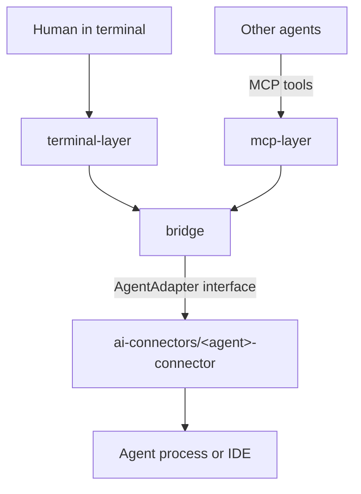

# Cross-Agent-Mcp-Bridge: How It Works

Cross-Agent-Mcp-Bridge lets one AI agent hand a message to another agent. Connected today: Codex, Claude Code, GitHub Copilot and Gemini (see the table in section 2). The code is built so more agents can be added without touching the core.

## Words used in this project

Code comments use these words without explaining them again. Look them up here.

| Word | Meaning |
|---|---|
| **agent** | An AI assistant the relay can talk to, such as Codex. |
| **adapter** | The code that talks to one specific agent. Every adapter has the same three methods: `run`, `readStatus`, `close`. |
| **connector** | The folder that holds everything for one agent (`ai-connectors/<agent>-connector/`). |
| **bridge** | The generic core that reads `@agent message`, picks the adapter, runs one turn and logs it. |
| **MCP** | The protocol agents use to call tools. The relay uses the official v2 split SDK (`@modelcontextprotocol/server` and `@modelcontextprotocol/client`) for agent messaging/status and shared agent-room tools. |
| **JSON-RPC** | A message format with one request or reply per line. Codex's server speaks it. |
| **app-server** | The background process the Codex extension runs. It does the real work. |
| **wrapper** | A small program VS Code starts instead of the Codex server, so the relay can listen in and send turns. |
| **socket** | A local file programs use like a network connection. |
| **thread** | One conversation with an agent. |
| **turn** | One question and its full answer. |
| **approval** | A request before an agent runs a command or changes a file. The relay accepts it automatically unless human review was requested. |
| **IDE mode / CLI mode** | `ide`: go through the Codex extension in VS Code. `cli`: start Codex's own process. |
| **JSONL** | A log file with one JSON object per line. |

## 1. The big picture



Rule that keeps this clean: **`bridge/`, `mcp-layer/` and `terminal-layer/` contain no agent-specific logic.** Agent logic lives in `ai-connectors/<agent>-connector/`, and `src/agent-modules.ts` is the one list of connectors. (Comments and tests may use "codex" as an example.)

A future `ahp-layer/` (VS Code agent UI talking to the relay over the Agent Host Protocol) will sit beside `mcp-layer/` and use the same bridge. It is not built yet.

## 2. Folders and files

| Path | What it is |
|---|---|
| `src/main.ts` | The one entry point. `main.ts` runs the terminal chat, `main.ts mcp` runs the MCP server. |
| `src/agent-modules.ts` | The only place agents are listed. Adding an agent = one line here. |
| `src/bridge/bridge-service.ts` | The heart. Queues `@agent` messages, picks the adapter, runs one turn at a time, logs every event, and handles approvals. |
| `src/bridge/agent-room-manager.ts` | Room files, task status/assignment, onboarding, membership, and persisted activity events. |
| `src/bridge/coordination-service.ts` | Cooperative task file claims and Git worktree operations. |
| `src/bridge/approval-queue.ts` | Holds explicitly requested MCP approval reviews until the user decides in the dashboard. |
| `src/dashboard/` | Local Material 3 dashboard, REST snapshot, server-sent live updates, and approval controls. |
| `src/bridge/event-log-service.ts` | Append-only JSONL log of every message in `<target repo>/.cross-agent-mcp-bridge/log/`. |
| `src/bridge/agent-registry.ts` | Builds one adapter per agent module. One agent failing to start does not stop the others. |
| `src/bridge/bridge-config.ts` | Settings shared by all agents (target repo, log folder). |
| `src/bridge/types/` | The contracts: `AgentAdapter`, `AgentModule`, `RelayEvent`. |
| `src/bridge/utils/` | Small pure helpers (mention parser, request token, async queue, settings-file planner, ...). |
| `src/ai-connectors/codex-connector/` | Codex. Root: agent module and config (also finds the Codex program). `cli/`: own Codex thread (adapter + JSON-RPC client). `ide/`: turns inside the Codex IDE (adapter, wrapper, socket protocol). |
| `src/ai-connectors/claude-connector/` | Claude Code. Root: agent module, config, stream-json line reader. `cli/`: own `claude -p` process. `ide/`: wrapper in front of the Claude extension's process, plus its adapter and socket protocol. |
| `src/ai-connectors/copilot-connector/` | GitHub Copilot, IDE only. Finds VS Code's agent host (registry, token, Unix socket), talks the agent host protocol with `ws`, picks the session, reads the reply. |
| `src/ai-connectors/gemini-connector/` | Gemini. `cli/`: Agent Client Protocol (ACP) to the Gemini CLI over stdio. `ide/`: the open Antigravity window, found through its local hub (gRPC-Web JSON), one conversation per folder. |
| `src/vscode-setup/` | Plans the one-line edit to VS Code `settings.json` (used by the setup skill script). |
| `src/mcp-layer/` | One Streamable HTTP MCP server: agent, skill (serves `skills/*.md` to the model), room, and coordination tools. |
| `src/terminal-layer/` | Terminal chat and the terminal approval prompt. |
| `src/ai-connectors/codex-connector/ide/codex-ide-wrapper.sh` | What VS Code's `chatgpt.cliExecutable` setting points at. Falls back to the real Codex if the relay cannot run. |
| `skills/` | `tools.md` covers direct agent tools; `rooms.md` covers shared room workflows; `GUIDE.md` indexes both. The project-root `setup.skill.md` covers server and client setup. |
| `tests/` | Mirrors `src/`. `tests/fixtures/` holds fake agents and fake servers (Codex, Claude, Gemini, VS Code agent host). |
| `knowledge.md` | Short project memory for any agent that resumes the work. |

### Connected agents

| Agent | Mention | `cli` mode | `ide` mode | Tested against |
|---|---|---|---|---|
| Codex | `@codex` | Yes: own Codex process; the relay answers action approvals | Yes: wrapper set through `chatgpt.cliExecutable`; provider approval behavior applies | Real Codex (live) and a fake server |
| Claude Code | `@claude` | Yes: `claude -p` over stream-json; the relay answers action approvals | Yes: wrapper set through `claudeCode.claudeProcessWrapper`; provider approval behavior applies | Fake `claude` only |
| GitHub Copilot | `@copilot` | No (no safe non-interactive approval flow) | Yes: VS Code agent host protocol, approvals stay in VS Code | Fake agent host only |
| Gemini | `@gemini` | Yes: Gemini CLI over ACP; the relay answers action approvals | Yes: the open Antigravity window's local hub (private API, found from the process list); provider approval behavior applies | Antigravity route: real Antigravity (live) and a fake hub. CLI route: fake ACP agent only (Gemini CLI is not installed here) |

The `agy` program is not supported because its print-mode approval behavior is unknown. Codex approval and sandbox settings, and Gemini approval mode, follow each agent's defaults or the corresponding relay environment variables.

## 3. What happens to one message

Example: an agent calls `send_to_agent({agent: "codex", message: "..."})`.

1. **mcp-layer** checks the agent name exists, then builds the text `@codex ...` and hands it to the bridge.
2. **bridge-service** queues the message if a turn is running, parses the mention, finds the adapter, creates a request token, and logs `user_message`.
3. The **adapter** sends the text. MCP mode prefers a CLI adapter when one is installed, allowing the relay to handle action approvals. An IDE adapter remains available when no CLI route exists.
4. The agent streams its answer back through the adapter.
5. If the agent asks the relay to approve a command or file change, the relay accepts and logs it automatically. `requireHumanApproval: true` makes that send wait for a decision in the dashboard. IDE-hosted providers can still present their own approval prompts.
6. Each piece of the answer becomes a `reply_delta` event (logged), and the final `turn/completed` ends the turn.
7. **mcp-layer** joins the deltas into one text and returns it to the calling agent.

In the terminal path the human types `@codex ...` in `terminal-layer/chat-command.ts`; steps 2 to 6 are the same. Prefix a message with `/review ` to decide its action approvals in the terminal.

## 4. Why it is built this way

- **One adapter per agent behind one interface.** Every agent speaks a different protocol. The bridge only knows `run()`, `readStatus()` and `close()`, so a new agent never changes the core.
- **MCP does not replace adapters.** MCP is agent-to-relay (the agent must call a tool). It cannot push a prompt into an idle agent. Adapters do that (relay-to-agent).
- **A wrapper for the Codex IDE.** VS Code runs Codex's server over private pipes, so no outside program can join it. The only way into the IDE's thread is to sit in front of that server through `chatgpt.cliExecutable`. That setting is marked development-only by the cross-agent_mcp project, so extension updates can break it.
- **JSONL log, one file per conversation.** Append-only means a crash damages at most the last line. Writes go through a single queue so lines never mix.
- **Agent modules.** `describeVscodeSetting()` lets each agent say which VS Code setting it needs, so the settings script has no agent-specific code.

## 5. Communication behavior

- The relay automatically accepts action approvals by default. Explicit human review uses the terminal prompt or the MCP `ApprovalQueue` and dashboard. Aborted turns cancel instead of accepting.
- Provider settings control each agent's own approval and sandbox behavior. The relay passes through the Codex and Gemini settings when configured.
- Text an agent supplies for an approval prompt is stripped of terminal control codes, so it cannot fake the prompt.
- A cancelled relay request stops the active turn. Turn/session identifiers keep concurrent conversations separate.
- The VS Code settings script is dry-run by default, saves a backup, adds one key and never overwrites a different value.
- Starting the MCP relay does not create a room. Agents call `get_room_setup` to inspect existing rooms and the target path, then explicitly call `create_room` when the project needs one. Passing `participantId` joins the creator in the current MCP session; otherwise call `join_room` separately. The room contains `ROOM.md` with its coordinator, task and message files, knowledge and decisions, membership records, and an append-only `events.jsonl`. `RELAY_AGENT_ROOM` chooses the suggested room name and defaults to `backend`.
- `invite_to_room` can create an assigned task before waking an agent. The invitation and wake-up turn carry the task ID and tell the agent to use the room task, knowledge, and decision tools while working.
- Joining can be followed by `get_room_onboarding`, which returns room instructions, knowledge, decisions, and tasks assigned to that participant. Membership is bound to MCP sessions; sessions missing after process restart appear as interrupted, while task files retain their last status.
- Task-level file claims coordinate collaborators but are advisory: agents must claim before editing and release afterward. Git worktrees can isolate task branches when needed. Room and claim writes are serialized and atomically replaced where a whole file is updated.
- Room changes are persisted as concise events. MCP clients can subscribe to the `cross-agent-mcp-bridge://rooms/events` resource, and the dashboard refreshes over server-sent events. Messages and knowledge stay in room files; notifications do not copy full documents.
- MCP tools also include approval actions, file claim management, and task worktree management. One dashboard is served at `http://127.0.0.1:8000`; the shared Streamable HTTP MCP endpoint remains `http://127.0.0.1:38765/mcp`.
- Token usage and cost tracking are out of scope for this release.
- Room and conversation files are stored in the target repository for participating agents to share.
- Your own `~/.codex/config.toml` can pre-approve specific tools (for example one Google Drive tool). The relay cannot override that.

## 6. How to add an agent

1. Create `src/ai-connectors/<agent>-connector/` with an adapter (`run`, `readStatus`, `close`) and an `AgentModule`. Copy `ai-connectors/codex-connector/codex-agent-module.ts` as a template and keep that agent's settings in `<agent>-config.ts`.
2. Add the module to `src/agent-modules.ts`.
3. Update the connector-specific setup and status table in the root `setup.skill.md`.
4. Add tests under `tests/ai-connectors/<agent>-connector/`. `tests/fixtures/create-fake-agent-module.ts` shows the pattern.

## 7. Running and testing

```bash
npm start            # terminal chat: type "@codex hello"
npm run mcp          # shared localhost Streamable HTTP MCP server at 127.0.0.1:38765/mcp
npm run init         # preview the VS Code and MCP setup
npm run init -- --apply # apply the previewed setup
npm run mcp          # also serves the local dashboard at 127.0.0.1:8000
npm run typecheck
npm test             # fake agents and a fake Codex server, no real model calls
```

Live checks done during development: a real Codex answered through the terminal (CLI), through the IDE wrapper, and through the MCP server; an approval request was declined by the human and nothing was written.

## 8. Known limits

- Codex and the Gemini Antigravity route have been tried against the real program. Claude, Copilot and the Gemini CLI route are covered by tests with fake servers and still need a real-world check. There is no AHP layer.
- It is not confirmed that the Codex IDE lists a thread the relay started.
- IDE mode depends on a development-only VS Code setting and on Codex's app-server protocol, which is not formally documented.
- MCP clients connect to the shared Streamable HTTP endpoint; the setup guide documents user-level client configuration for Codex, Claude Code, Copilot in VS Code, and Gemini CLI.
