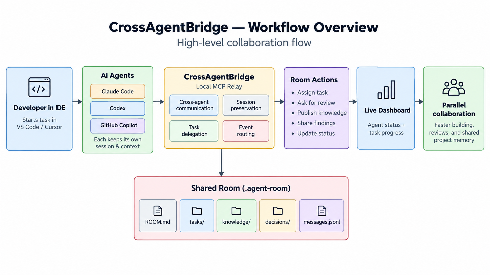
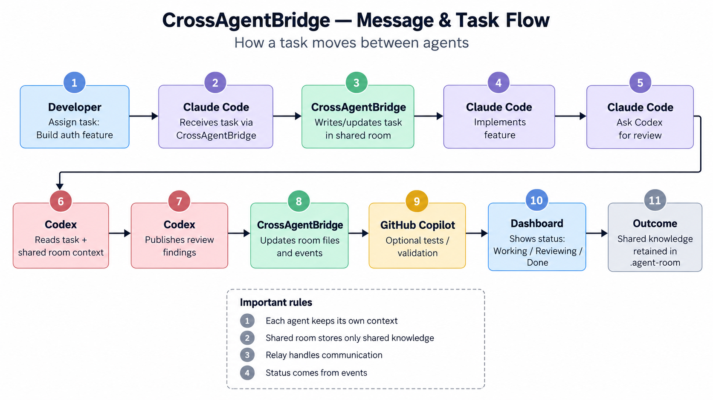
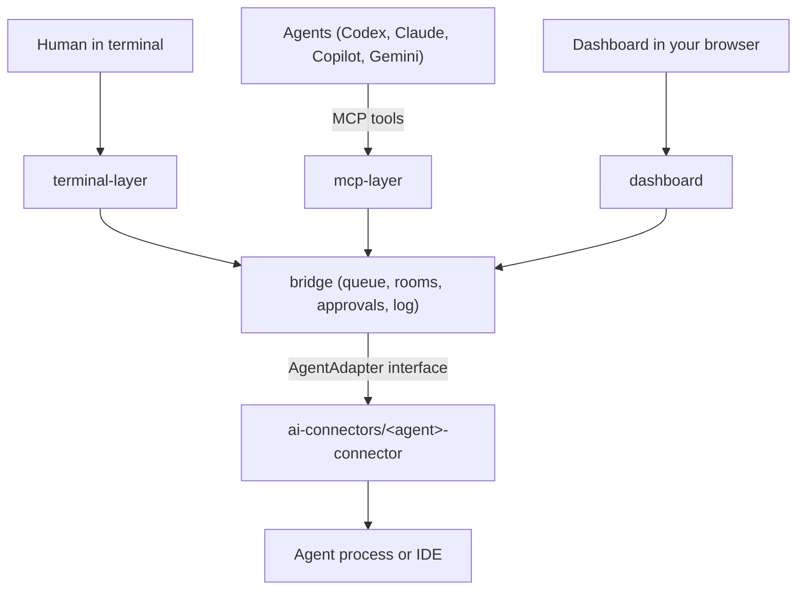
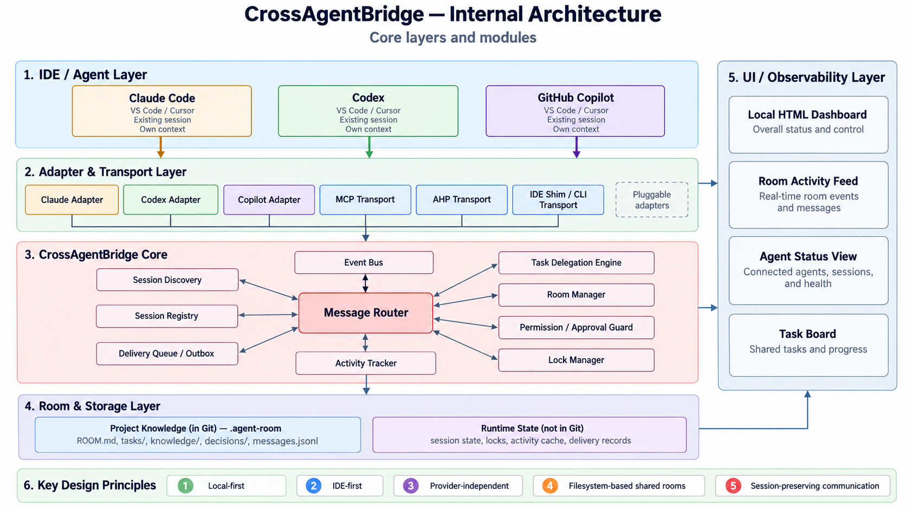
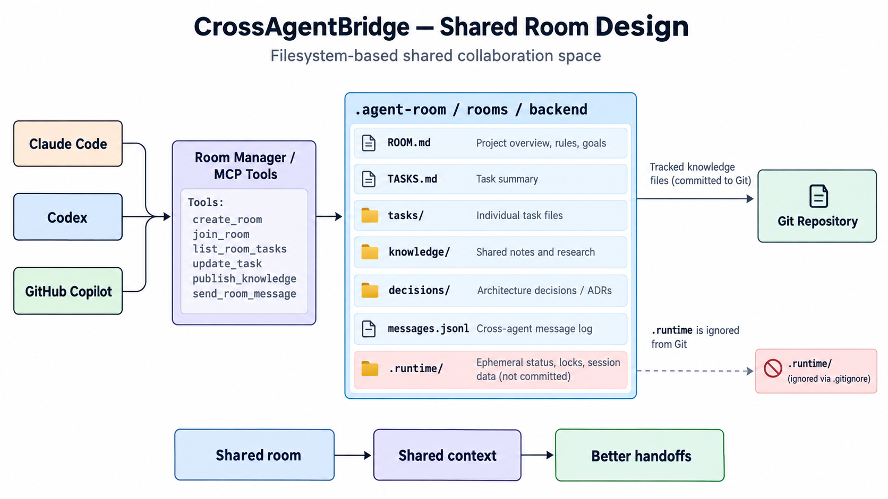

# Cross-Agent-Mcp-Bridge


**Let your Codex, Claude Code, GitHub Copilot and Gemini sessions hand work to each other, share a project room, and be watched from one local dashboard.**

Cross-Agent-Mcp-Bridge is one shared MCP server that runs on your machine. Any agent that can call MCP tools can use it to:

- send a message to another agent and get that agent's reply back (`send_to_agent`),
- open a **shared room** inside a repository where several agents keep tasks, messages, knowledge and decisions,
- **claim files** before editing and isolate a task on its own **Git worktree**,
- read **usage guides** written for models (`list_skills` / `get_skill`), so an LLM learns how to use the tools without you pasting instructions.

You also get a terminal chat (`@codex hello`), a live dashboard, and an append-only event log of every message.



Adding another agent takes one new connector folder and one line in `src/agent-modules.ts`. The core never contains agent-specific code.

## What it is good for

- **Get a second opinion.** Ask Gemini to review Claude's plan, or Codex to double-check a refactor, and keep working while it answers.
- **Split a large task.** A coordinator agent creates tasks, assigns them to other agents, and tracks them from `open` to `done`.
- **Avoid stepping on each other.** Agents claim the files a task owns before editing, and can work on separate Git worktrees.
- **Keep a shared memory.** Reusable findings go in room *knowledge*, settled choices go in *decisions*, and both outlive any single chat.
- **Review risky actions.** The relay approves an agent's own command and file prompts automatically by default. Add `requireHumanApproval: true` to review them in the dashboard instead.

### A typical exchange

1. Claude calls `get_room_setup` with the project path, then `create_room`.
2. Claude calls `invite_to_room` for `codex` with a task: "Add tests for `src/auth`". The relay posts the invitation, creates the assigned task and wakes Codex.
3. Codex calls `join_room`, `get_room_onboarding`, works the task, and records progress with `update_task` and `set_task_status`.
4. Claude reads the result with `list_room_tasks` and `get_room_context`, then asks Gemini for a review with `send_to_agent`.
5. You watch all of it, and can approve or decline actions, on `http://127.0.0.1:8000`.



## Contents

- [1. Requirements](#1-requirements)
- [2. Installation and first run](#2-installation-and-first-run)
- [3. Registration (connect your agents)](#3-registration-connect-your-agents)
- [4. VS Code adapter settings](#4-vs-code-adapter-settings)
- [5. Connected agents](#5-connected-agents)
- [6. Tools](#6-tools)
- [7. Rooms](#7-rooms)
- [8. Approvals](#8-approvals)
- [9. Dashboard](#9-dashboard)
- [10. Skills for models](#10-skills-for-models)
- [11. Security model](#11-security-model)
- [12. Environment variables](#12-environment-variables)
- [13. Terminal chat](#13-terminal-chat)
- [14. Verification and troubleshooting](#14-verification-and-troubleshooting)
- [15. Project layout](#15-project-layout)
- [16. Adding an agent](#16-adding-an-agent)
- [17. Known limits](#17-known-limits)
- [License](#license)





---

## 1. Requirements

- Node.js and npm. TypeScript runs directly through `tsx`; there is no build step.
- At least two of the supported agents, for agent-to-agent work.
- **CLI mode** (preferred when available): the agent's own program installed and signed in: `codex`, `claude`, or the Gemini CLI.
- **IDE mode** (fallback or only route): VS Code for Codex, Claude Code and Copilot; the Antigravity window for Gemini.
- GitHub Copilot is IDE-only. It needs VS Code open with its Agent Host available.
- Developed on macOS. The relay talks to local Unix sockets, so macOS or Linux is the supported target.

## 2. Installation and first run

```bash
npm install
npm run mcp
```

Keep this process running while agents use the relay. It starts **one shared server**:

| What | Address |
|---|---|
| MCP endpoint (Streamable HTTP) | `http://127.0.0.1:38765/mcp` |
| Dashboard | `http://127.0.0.1:8000` |

Start one server for all your agents. Each client connects to that URL; do not start one server per client. If the endpoint is already active, use it instead of starting a duplicate.

The server's working directory (or `RELAY_TARGET_REPO`) decides where relay logs go. It does **not** decide where a room is created: the agent passes the project path to `get_room_setup` and `create_room`, and the room is written inside that project.

> [!NOTE]
> MCP clients connect to the server **once, when their session starts**, and do not retry. Start `npm run mcp` *before* you open the client. If you start it afterwards, reload the client or reconnect with `/mcp`.

## 3. Registration (connect your agents)

Add one `cross-agent-mcp-bridge` entry to each client's **user-level** MCP settings. Merge it in; keep your other servers and settings. If an entry already exists, update its URL instead of adding a duplicate.

### Codex

File: `~/.codex/config.toml`

```toml
[mcp_servers.cross-agent-mcp-bridge]
url = "http://127.0.0.1:38765/mcp"
```

Check with `codex mcp list`.

### Claude Code

File: `~/.claude.json`. Merge into the top-level `mcpServers` object:

```json
{
  "mcpServers": {
    "cross-agent-mcp-bridge": {
      "type": "http",
      "url": "http://127.0.0.1:38765/mcp"
    }
  }
}
```

### GitHub Copilot in VS Code

Use the **user-level** MCP file, not a repository's `.vscode/mcp.json`:

- macOS: `~/Library/Application Support/Code/User/mcp.json`
- Linux: `~/.config/Code/User/mcp.json`
- Windows: `%APPDATA%\Code\User\mcp.json`

```json
{
  "servers": {
    "cross-agent-mcp-bridge": {
      "type": "http",
      "url": "http://127.0.0.1:38765/mcp"
    }
  }
}
```

### Gemini CLI

File: `~/.gemini/settings.json`

```json
{
  "mcpServers": {
    "cross-agent-mcp-bridge": {
      "httpUrl": "http://127.0.0.1:38765/mcp"
    }
  }
}
```

### Reload and verify

Restart or reload each client, and approve the server if it asks. Confirm the client's tool list includes `send_to_agent`, `list_agents`, `relay_status`, `list_skills` and the room tools. Then call `relay_status`.

A client being connected means its **tools exist**. Whether `send_to_agent` can reach a given agent depends on that agent's own connector being online. `list_agents` and `relay_status` show both.

## 4. VS Code adapter settings

MCP entries give a client the relay's tools. The IDE routes also need a VS Code setting for Codex and Claude. Preview the change from the project root:

```bash
npx tsx configure-vscode-settings.ts           # preview only
npx tsx configure-vscode-settings.ts --apply   # write it
```

`npm run init` runs the same preview, and `npm run init -- --apply` writes the settings **and** creates the default `backend` room. The script:

- adds only settings the available connectors declare,
- preserves your other VS Code settings and never overwrites a different value,
- saves a backup before writing.

Restart VS Code after applying. To configure one agent, add `--agent codex`, `--agent claude`, `--agent copilot` or `--agent gemini`.

> [!WARNING]
> The Codex route depends on `chatgpt.cliExecutable`, a setting the Codex extension marks "DEVELOPMENT ONLY", and on an undocumented app-server protocol. Extension updates can break it. To revert, delete that setting and fully quit and reopen VS Code (Reload Window can leave the old wrapper running).

## 5. Connected agents

| Agent | Mention | CLI mode | IDE mode | Tested against |
|---|---|---|---|---|
| Codex | `@codex` | Yes: own Codex process; the relay answers action approvals | Yes: wrapper set through `chatgpt.cliExecutable` | Real Codex (live) and a fake server |
| Claude Code | `@claude` | Yes: `claude -p` over stream-json; the relay answers action approvals | Yes: wrapper set through `claudeCode.claudeProcessWrapper` | Fake `claude` only |
| GitHub Copilot | `@copilot` | No (no safe non-interactive approval flow) | Yes: VS Code Agent Host protocol; approvals stay in VS Code | Fake agent host only |
| Gemini | `@gemini` | Yes: Gemini CLI over ACP; the relay answers action approvals | Yes: the open Antigravity window's local hub | Antigravity route live; CLI route fake only |

How the route is chosen:

- MCP calls **prefer the CLI route** for Codex, Claude and Gemini, so the relay can handle approvals. IDE routes keep the provider's own approval prompts.
- Copilot only has an IDE route. If no Copilot session exists, the relay creates one in the requested workspace.
- With several VS Code windows, set `RELAY_COPILOT_SESSION_ID` to choose the Copilot session.
- The `agy` program is **not** used, because its print-mode approval behavior is unknown.

Per-agent connector notes:

| Agent | VS Code setup | Notes |
|---|---|---|
| Codex | The script sets `chatgpt.cliExecutable` to the relay wrapper. Install the Codex extension. | Falls back from the CLI to the IDE wrapper. Overrides: `RELAY_CODEX_MODE`, `RELAY_CODEX_BINARY`, `RELAY_CODEX_IDE_SOCKET_DIRECTORY`. |
| Claude Code | The script sets `claudeCode.claudeProcessWrapper`. Install the Claude CLI for relay-handled approvals. | Overrides: `RELAY_CLAUDE_MODE`, `RELAY_CLAUDE_BINARY`, `RELAY_CLAUDE_IDE_SOCKET_DIRECTORY`. |
| GitHub Copilot | No VS Code setting. Keep VS Code open. | `relay_status` reports `hostRunning`. Overrides: `RELAY_COPILOT_SESSION_ID`, `RELAY_COPILOT_ENDPOINT_DIRECTORY`. |
| Gemini | No VS Code setting. Install and sign in to Gemini CLI. | Overrides: `RELAY_GEMINI_BINARY`, `RELAY_GEMINI_ACP_FLAG`, `RELAY_GEMINI_IDE_TIMEOUT_MS`, `RELAY_GEMINI_MODE`. |

## 6. Tools

The server exposes these MCP tools. Agents can read the same information in detail through `list_skills` and `get_skill` (see [section 10](#10-skills-for-models)).

### Direct messaging

| Tool | Use |
|---|---|
| `list_agents` | List available and unavailable agents. One is marked `coordinator`, the others `worker`. |
| `send_to_agent` | Send a self-contained message to an agent and get its reply. Optional `requireHumanApproval`. |
| `relay_status` | Show each connector's live state, the log location, room locations and current activity. |

```json
{
  "agent": "claude",
  "message": "Review src/auth/session.ts for edge cases. Return findings with file and line references; do not edit files."
}
```

Write messages so they stand alone. The other agent does **not** see your conversation, so include the goal, paths, constraints and expected result. Messages queue in arrival order when a turn is already running.

### Skills (usage guides for the model)

| Tool | Use |
|---|---|
| `list_skills` | List the relay's guides with name, title and a one-line summary. The index (`guide`) comes first. |
| `get_skill` | Return one guide's full markdown by name. An unknown name returns the list of valid names. |

### Rooms, tasks and knowledge

| Tool | Use |
|---|---|
| `get_room_setup` | Inspect rooms in a repository; returns the suggested room path if none exist. |
| `create_room` | Create a room. Optional `participantId` joins the creator and records them as coordinator. |
| `list_rooms` | List rooms in a repository. |
| `join_room` / `leave_room` | Record membership for the current MCP session. |
| `list_room_members` | See joined, left and interrupted sessions. |
| `get_room_onboarding` | Load room instructions, knowledge, decisions and the participant's assigned tasks. |
| `get_room_context` | Read room metadata, the task index and recent messages. |
| `list_room_tasks` | Read task files and statuses. |
| `create_task` / `assign_task` | Add a task (optional assignee and file list) or change its owner. |
| `update_task` / `set_task_status` | Add a progress note, or set `open`, `in_progress`, `review` or `done`. |
| `send_room_message` | Share a concise update or handoff. |
| `publish_knowledge` / `search_knowledge` | Save and search reusable context. |
| `publish_decision` / `list_room_decisions` | Record and read settled choices. |
| `invite_to_room` | Post an invitation and wake another agent; optional `task` creates an assigned task first. |
| `list_invitable_agents` | Show who is in the room, interrupted, disconnected, or free to invite. |

Room messages alone never wake an agent. `invite_to_room` posts the message **and** sends the agent a relay turn.

### File claims and worktrees

| Tool | Use |
|---|---|
| `claim_task_file` / `release_task_file` | Record or release a claim on a task-listed, repository-relative file. |
| `list_task_file_claims` | Inspect active claims, optionally for one room. |
| `create_task_worktree` | Create a Git worktree and branch `agent-room/<room>/<task>` in a sibling `<repo>-agent-worktrees` folder. |
| `list_task_worktrees` | List the relay's task worktrees. |
| `remove_task_worktree` | Remove one; Git refuses if it has uncommitted changes. |

Claims are **advisory**: they coordinate collaborators but do not lock a file against editors outside the relay.

### MCP resource

`cross-agent-mcp-bridge://rooms/events` returns concise room change summaries. Subscribe to be notified, then read the relevant tool or file for details. Events are summaries, not copies of documents.

## 7. Rooms

A room is a folder inside the repository the agent names:

```text
<targetRepositoryPath>/.agent-room/rooms/<room-name>/
  ROOM.md          coordinator, instructions
  TASKS.md         task index, rebuilt on every task change
  tasks/           one markdown file per task
  knowledge/       reusable notes
  decisions/       recorded choices
  participants/    one file per participant
  messages.jsonl   room messages
  events.jsonl     change summaries
  members.jsonl    membership records
```



- **Starting the server never creates a room.** Only `create_room` or `npm run init -- --apply` does.
- **Repository-scoped IDs.** Two repositories can each have a room named `backend`; the IDs returned by the tools keep them apart. Pass the exact IDs the tools return.
- **Coordinator.** Each new room records its coordinator: the creator when `participantId` is passed, otherwise the relay's coordinator. `RELAY_COORDINATOR_AGENT` chooses it; the default is the first available agent.
- **Membership is tied to MCP sessions.** After a server restart, missing sessions show as `interrupted`; task files keep their last status. Idle MCP sessions expire after 30 minutes and are marked as left.
- **Large logs stay cheap.** Recent events and messages are read from the end of the log files, so reading them does not slow down as the files grow.

Start, join and onboard:

```text
get_room_setup  { "targetRepositoryPath": "/absolute/path/to/project" }
create_room     { "name": "backend", "targetRepositoryPath": "/absolute/path/to/project", "participantId": "claude" }
get_room_onboarding { "roomId": "backend" }
```

## 8. Approvals

When an agent asks to run a command or change a file:

- **Default:** the relay accepts the request automatically and logs the decision. This is what makes unattended agent-to-agent work possible.
- **Human review:** pass `requireHumanApproval: true` to `send_to_agent`, or start a terminal message with `/review `. The request then waits in the dashboard (or terminal prompt) for you to accept, decline or cancel.
- **Provider prompts:** IDE routes and Copilot keep the provider's own prompts, which the relay cannot answer. The relay's choice only covers approvals it handles itself.
- Aborted turns cancel instead of accepting.
- Text an agent supplies for an approval prompt is stripped of terminal control codes, so it cannot fake the prompt.

Approval and sandbox settings of Codex and Gemini follow each agent's defaults, or the matching `RELAY_` variables ([section 12](#12-environment-variables)).

## 9. Dashboard

Open `http://127.0.0.1:8000` while the server runs. It shows:

- connected agents and what each is doing,
- rooms, members and the task board,
- pending approvals, with accept / decline / cancel,
- file claims and task worktrees,
- recent room events, updated live over server-sent events.

From the dashboard you can create and update tasks, send a room message, claim or release a file, and dispatch a message to an agent.

## 10. Skills for models

The `skills/` folder holds short markdown guides written for LLMs:

| Guide | Covers |
|---|---|
| `guide` | Index of the guides below. Start here when unsure. |
| `tools` | Choosing and calling the direct agent tools; delegating to one or more agents. |
| `rooms` | Creating and joining rooms, onboarding, tasks, messages, knowledge, file claims, worktrees. |

A model calls `list_skills`, then `get_skill` with a name, and reads only what it needs. Any `.md` file you add to `skills/` is picked up automatically. Server and client setup is **not** served this way; it lives in [setup.skill.md](setup.skill.md).

## 11. Security model

Cross-Agent-Mcp-Bridge is built for **one developer's machine**.

- Both servers listen on `127.0.0.1` only.
- Every request must carry a localhost `Host` header, and any `Origin` header must be a localhost origin. A request from a website or a DNS-rebinding page is refused with `403`.
- Dashboard writes must be `application/json`; other content types get `415`. This closes the cross-site `text/plain` trick that needs no browser permission check.
- `Origin`-less clients (Codex, Claude Code, curl) are accepted.
- Only a valid MCP `initialize` request can open a session. Unknown session IDs get `404`.
- There is **no login token**. Any program on your machine can call the relay, and the relay auto-approves agent actions by default. Do not expose either port beyond localhost.
- Room tools accept any absolute repository path, so a caller can create room files wherever your user can write. Treat connected agents as trusted.
- IDE connectors refuse a socket folder that is not private.
- Agent prompts and the event log are plain files in your repository. There is no log redaction yet.

## 12. Environment variables

Set these in the shell that runs `npm run mcp`.

| Variable | Purpose |
|---|---|
| `RELAY_TARGET_REPO` | Project the relay works in. Defaults to the working directory. |
| `RELAY_LOG_DIRECTORY` | Where the JSONL log is written. Default: `<target repo>/.cross-agent-mcp-bridge/log/`. |
| `RELAY_AGENT_ROOM` | Suggested room name. Default: `backend`. |
| `RELAY_COORDINATOR_AGENT` | Which agent coordinates new rooms. Default: first available. |
| `RELAY_AGENT_NAME` | Participant name the relay itself uses in rooms. Default: `cross-agent-mcp-bridge`. |
| `RELAY_CODEX_MODE` | `cli` (default) or `ide`. |
| `RELAY_CODEX_BINARY` | Path to the Codex program. |
| `RELAY_CODEX_IDE_SOCKET_DIRECTORY` | Where the Codex IDE wrapper's sockets live. |
| `RELAY_CODEX_APPROVAL_POLICY` / `RELAY_CODEX_SANDBOX` | Sent to Codex only if set; otherwise Codex applies your own defaults. |
| `RELAY_CLAUDE_MODE` | `cli` or `ide`. |
| `RELAY_CLAUDE_BINARY` | Path to the Claude CLI. |
| `RELAY_CLAUDE_IDE_SOCKET_DIRECTORY` | Where the Claude IDE wrapper's sockets live. |
| `RELAY_COPILOT_SESSION_ID` | Choose the Copilot session when several windows are active. |
| `RELAY_COPILOT_ENDPOINT_DIRECTORY` | Override where the VS Code Agent Host is discovered. |
| `RELAY_GEMINI_MODE` | `cli` or `ide`. |
| `RELAY_GEMINI_BINARY` | Path to the Gemini CLI. |
| `RELAY_GEMINI_ACP_FLAG` | Override the CLI flag used for the Agent Client Protocol. |
| `RELAY_GEMINI_APPROVAL_MODE` | Gemini approval mode; otherwise Gemini's default. |
| `RELAY_GEMINI_IDE_TIMEOUT_MS` | Timeout for the Antigravity route. |

The ports (38765 for MCP, 8000 for the dashboard) are fixed, so two relays cannot run on one machine at the same time.

## 13. Terminal chat

```bash
npm start
```

Type `@codex hello`, `@claude ...`, `@copilot ...` or `@gemini ...`. Prefix a message with `/review ` to decide its action approvals in the terminal.

## 14. Verification and troubleshooting

```bash
npm run typecheck
npm test            # fake agents and fake servers only; no real model calls
```

Check a running relay:

- `relay_status` reports each connector's live state, relay log and room locations.
- `list_agents` shows which agents loaded and why any are unavailable.

Common problems:

| Symptom | Cause and fix |
|---|---|
| Client says the server is unreachable, or no `send_to_agent` tool | The relay was not running when the client started. Run `npm run mcp`, then reload the client or reconnect with `/mcp`. |
| `EADDRINUSE` on 38765 or 8000 | A relay is already running. Use it, or stop it first. |
| `send_to_agent` says the agent is unavailable | That agent's connector is offline. Check `list_agents` for the reason and install or sign in to its CLI. |
| Codex IDE route stopped working after a VS Code or extension update | The development-only setting or protocol changed. Revert the setting and use CLI mode. |
| Requests from a script get `403` | Send `Host` as `127.0.0.1` or `localhost` and no foreign `Origin`. |
| Dashboard writes get `415` | Send `Content-Type: application/json`. |

The test suite currently has two known failures in `copilot-ide-adapter.test.ts` (session creation through the Agent Host); they are not caused by recent changes and are not yet diagnosed.

## 15. Project layout

```text
src/
  main.ts              entry point: chat, mcp or init
  agent-modules.ts     the one list of connected agents
  bridge/              generic core: queue, rooms, claims, approvals, log
  ai-connectors/       one folder per agent (codex, claude, copilot, gemini)
  mcp-layer/           MCP server, tools and session registry
  terminal-layer/      terminal chat and approval prompt
  dashboard/           local dashboard
  vscode-setup/        VS Code settings planner
skills/                guides served to models
tests/                 mirrors src/, with fake agents in tests/fixtures/
docs/images/           diagrams
```

The core (`bridge/`, `mcp-layer/`, `terminal-layer/`) contains no agent-specific code. See **[ARCHITECTURE.md](ARCHITECTURE.md)** for how a message flows and why it is built this way.

### What happens to one message

1. `mcp-layer` checks the agent name exists and builds `@codex ...`.
2. `bridge-service` queues it if a turn is running, finds the adapter, creates a request token and logs `user_message`.
3. The adapter sends the text over the CLI or IDE route.
4. The agent streams its answer back; each piece is logged as `reply_delta`.
5. Approval requests are accepted automatically, or held for you if `requireHumanApproval` was set.
6. The turn completes, and the deltas are joined and returned to the caller.

Every message is appended to a JSONL log in `<target repo>/.cross-agent-mcp-bridge/log/`, one file per conversation. Appends go through a single queue, so a crash damages at most the last line.

## 16. Adding an agent

1. Create `src/ai-connectors/<agent>-connector/` with an adapter (`run`, `readStatus`, `close`) and an `AgentModule`. Copy the Codex connector as a template and keep the agent's settings in `<agent>-config.ts`.
2. Add the module to `src/agent-modules.ts`.
3. Add it to the connector table in [setup.skill.md](setup.skill.md).
4. Add tests under `tests/ai-connectors/<agent>-connector/`. `tests/fixtures/create-fake-agent-module.ts` shows the pattern.

## 17. Known limits

- Only Codex and the Gemini Antigravity route have been tried against the real program. Claude, Copilot and the Gemini CLI route are tested with fake servers only.
- Codex IDE mode depends on a development-only VS Code setting and an undocumented app-server protocol. It is not confirmed that the Codex IDE lists a thread the relay started.
- There is no AHP (Agent Host Protocol) server layer; VS Code agents cannot yet call the relay through it.
- Token usage and cost tracking are not included.
- No log redaction, per-turn timeout, or log rotation yet. Room and event logs grow until you remove them.
- Ports are fixed, and there is no authentication token on the local servers (see [section 11](#11-security-model)).
- The bundled diagrams are illustrative: they omit Gemini, mention Cursor (not supported), show an AHP transport (not built), and show a `.runtime/` folder a real room does not have. The Mermaid diagram above is accurate.

## More docs

- [setup.skill.md](setup.skill.md): server and client setup
- [ARCHITECTURE.md](ARCHITECTURE.md): design and internals
- [skills/GUIDE.md](skills/GUIDE.md), [skills/tools.md](skills/tools.md), [skills/rooms.md](skills/rooms.md): tool guidance for agents
- [knowledge.md](knowledge.md): project memory for agents resuming work
- [plan.md](plan.md): original plan

## License

ISC (see `package.json`).
